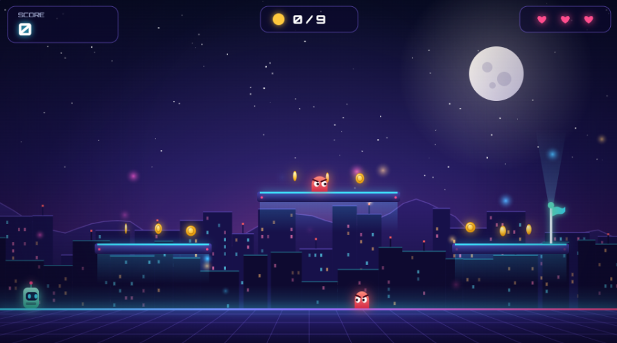
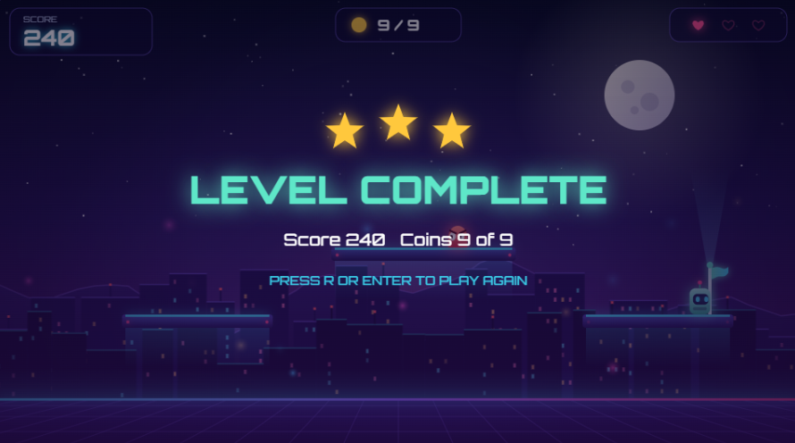

# Neon Dash

A neon-lit platformer built on a **custom Entity Component System (ECS) engine**, written in strict TypeScript. No game framework: the engine, physics, collision, particles and renderer are all written from scratch on the HTML canvas.

**[Play it here](https://tambesujal406-design.github.io/neon-dash/)**

<p align="center">
  
  
</p>

## Controls

| Action | Keys |
| --- | --- |
| Move | `A` `D` or the arrow keys |
| Jump | `Space`, `W` or the up arrow (tap for a hop, hold for a full jump) |
| Stomp an enemy | Land on it from above |
| Play again | `R` or `Enter` after the game ends |

Collect all 9 coins, avoid the red enemies (or stomp them), and reach the flag. You have 3 lives.

## How the engine works

- **Entities** are just IDs.
- **Components** are plain typed data (`Position`, `Velocity`, `Sprite`, `Collider`).
- **Systems** are functions that run every frame over the entities that have the components they need.
- **Resources** are world-wide singletons, like the score and lives (`world.getResource(GameState)`).

```ts
for (const [entity, pos, vel] of world.query(Position, Velocity)) {
  pos.x += vel.x * dt; // pos and vel are fully typed
}
```

Other engine features:

- Fixed-timestep game loop: logic always advances in equal steps, rendering happens once per frame
- Pause support: when the game ends, gameplay systems stop while rendering, particles and the restart check keep running
- Marker components (`Solid`, `OnGround`) used as state, added and removed as things change
- Axis-aware collision that resolves along the shortest way out, with a fall-speed cap to stop tunnelling

## Look and feel

- Neon dusk scene: gradient sky, twinkling stars, moon, shooting star, fireflies and three parallax layers that slide as the player moves
- Glowing platforms and a synthwave floor, spinning coins, a robot player with squash and stretch, wobbling enemies, a rippling goal flag
- Particles for dust, coin sparkles, stomps and a confetti burst on winning, plus screen shake on hits
- Animated HUD with a counting score, hearts for lives and a star rating on the end screen

The effects are ordinary ECS parts: `Particle`, `Squash` and `Facing` components, `Time` and `Camera` resources, and one system for each.

## TypeScript features used

- Generics and variadic tuple types for the typed `query()`
- Branded types for `Entity`
- Interfaces for `System`, classes for components and systems
- `strict`, `noUncheckedIndexedAccess` and `verbatimModuleSyntax`

## Project structure

```
src/
  engine/    World, GameLoop, Keyboard, geometry helpers and shared types
  components.ts
  systems/   Input, movement, gravity, jump, collision, patrol, pickups, enemies, goal, particles, rendering, HUD
  game/      Level setup, game state, effects, camera and clock resources
  render/    Drawing functions, parallax background and the colour theme
```

## Run it locally

```bash
npm install
npm run dev        # start the dev server
npm test           # run the unit tests
npm run typecheck  # type check only
npm run build      # production build in dist/
```

The 49 tests cover the engine, every gameplay system and a scripted playthrough that proves the level can be completed.

## Deploy

Push to `main`. The workflow in `.github/workflows/deploy.yml` tests, builds and publishes to GitHub Pages. In the repo settings, set Pages > Source to GitHub Actions.

## Roadmap

- [x] World, typed queries, game loop
- [x] Input, gravity, jumping and collision
- [x] Coins, patrolling enemies, goal flag, score, lives and restart
- [x] Neon visual polish (parallax, particles, animation, HUD)
- [ ] Debug overlay (hitboxes, velocity arrows, live entity inspector)
